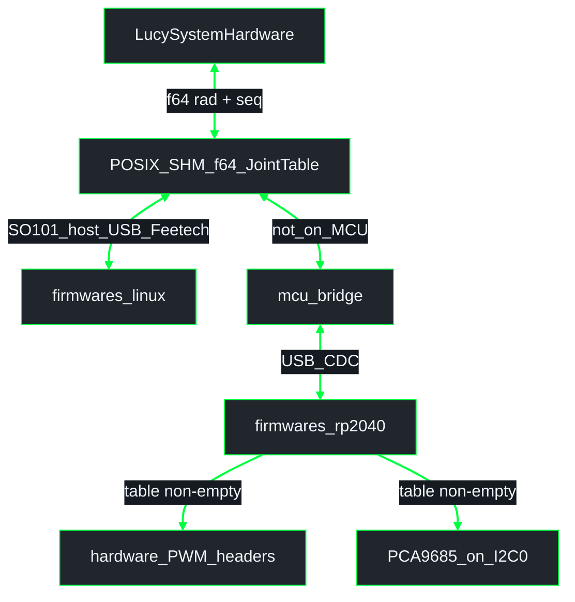
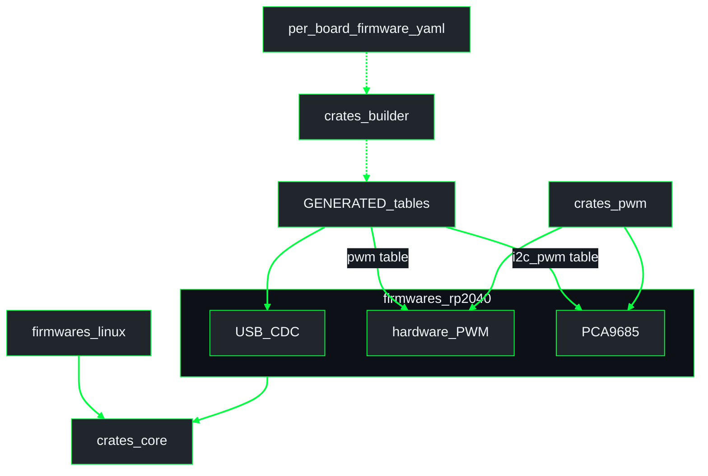

# Firmware architecture (one binary per board)

Detail for **`lucy_embedded_firmware`**.

**Workspace overview (when checked out under `lucy_ws/src/`):**  
[`lucy_control_panel/docs/architecture/overview.md`](../../../lucy_control_panel/docs/architecture/overview.md)  
**ROS pipeline / SHM:** [`lucy_ros_packages/docs/architecture/pipeline_shm.md`](../../../lucy_ros_packages/docs/architecture/pipeline_shm.md)  
**Index:** [README.md](README.md)

## Control path

Host `LucySystemHardware` exchanges **`f64` radians** with POSIX SHM (`ActuatorSharedState` / `JointTable`). The MCU never mmaps host SHM. One hardware interface and one host↔MCU bridge process run per board that has a non-empty USB `serial_id`. The bridge copies the whole table. It does not interpret plugs.

| Robot / profile | Path |
|-----------------|------|
| **SO-ARM101** | `firmwares/linux` mmaps SHM → **USB serial** Feetech. |
| **InMoov / Thais** | Servo2040 behind one `mcu_bridge` per board. Header plugs are hardware PWM. A PCA9685 hangs off the Qw/ST I2C port of that same Pico. |

**ABI:** ros `ActuatorSharedState` uses flat `double[MAX_ACTUATORS]` (`MAX_ACTUATORS=32`). Firmware `JointTable<N>` nests `CommandBlock` / `StateBlock` / `HeartbeatBlock`. Field sets match for the same `N`. SHM slot index is the actuator `virtual_pin`.

## What turns a bank on

Robot hardware YAML is the user document. The generator projects one firmware spec per board. Plugs in that spec fill the tables. `board_class` is only a label stored on save (`internal_servo_i2c_pwm` when the board has an I2C device, otherwise `internal_servo_only` for these PWM boards). The generator does not choose a C template from that label.

A bank initializes only when its generated table is non-empty. An empty PWM table leaves the PWM slices off. An empty I2C table leaves I2C off. Header PWM and I2C PCA9685 can both be non-empty on the same Pico.

`bus_servo_only` (UART Feetech) and the ADC bank stay in the architecture and are not part of the header-PWM image. That image does not initialize UART, so GPIO0, GPIO1, and GPIO16 remain Servo1, Servo2, and Servo17.

## Crate layout

Banks live in the crates on `dev`. There is no `rp2040_support` package.

**UML Component** — the per-board spec is a build input of `firmwares/rp2040`.

`crates/pwm` owns the only radians-to-microseconds map (`pulse_width_us`). The header bank and the PCA9685 driver both call it. `crates/builder` is a build dependency of `firmwares/rp2040`. Host Feetech stays in `firmwares/linux`.

UART Feetech (`crates/feetech`) and an ADC bank remain available as later tables. They are not compiled into the header-PWM image described here.

## Header PWM

Servo N is GPIO N−1. The slice runs at 50 Hz: `div_int = 125`, `top = 19999` (1 µs ticks at 125 MHz).

The RP2040 has 16 hardware PWM channels and the board has 18 headers. Servo1 (GPIO0) and Servo17 (GPIO16) share PWM slice 0 channel A. Servo2 (GPIO1) and Servo18 (GPIO17) share slice 0 channel B. A plug on either end works. Driving both ends of a pair yields one pulse on both horns, so the hardware schema rejects that pair. PIO is deferred until a board must command both ends to different widths.

I2C0 on the Qw/ST port (GPIO20 SDA, GPIO21 SCL, 3.3 V) is not a header. Those pins in I2C mode do not force Servo5 and Servo6, which share PWM slice 2 with GPIO20 and GPIO21, onto the same pulse. Pin function is per pin. Header PWM and a PCA9685 therefore coexist on one Pico.

## PCA9685

One I2C init per Pico at 400 kHz. Every PCA9685 on that board shares the bus and differs by 7-bit address (`0x40`–`0x7F`, default `0x40`). Servo power is not the Qw/ST 3.3 V pin. `OE` is held low by the breakout.

| Table row | Identity |
|-----------|----------|
| Header PWM | `ServoN` |
| PCA9685 channel | `I2C0:PCA9685:<address>:<channel>` |

`PRE_SCALE` is `121` for 50 Hz on the 25 MHz oscillator, written only while `MODE1` SLEEP is set. Outputs are totem-pole (`MODE2` OUTDRV). Channel N starts at register `0x06 + 4 * N`. Torque-off is duty 0 on a header and the PCA9685 full-OFF bit on a channel.

## Angles

| Layer | Unit |
|-------|------|
| Robot YAML / HI command interfaces | **radians** |
| Host SHM | **`f64` radians** + sequence counters |
| `pulse_width_us` and both banks | microseconds at the driver edge |

## Related

- Firmware README: [`../../README.md`](../../README.md)
- Control-panel overview: [`../../../lucy_control_panel/docs/architecture/overview.md`](../../../lucy_control_panel/docs/architecture/overview.md)
- ROS pipeline / SHM: [`../../../lucy_ros_packages/docs/architecture/pipeline_shm.md`](../../../lucy_ros_packages/docs/architecture/pipeline_shm.md)
